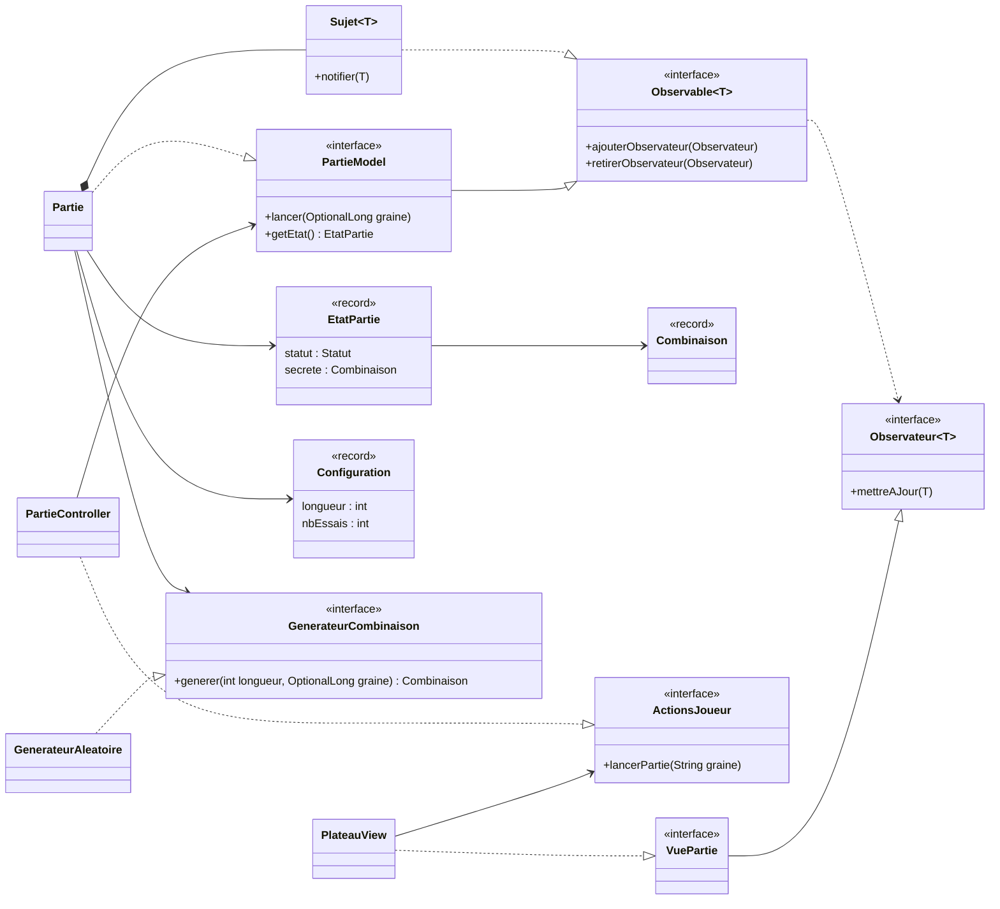
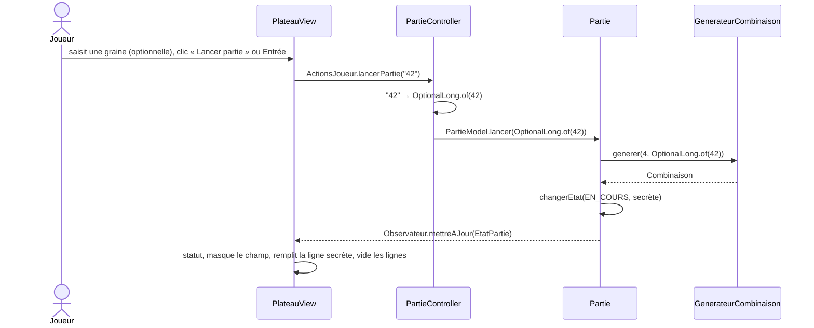

# Mastermind

Jeu de Mastermind en JavaFX, construit en MVC avec le patron Observer. Le joueur devine une combinaison secrète de couleurs en un nombre limité d'essais, guidé par des indices (pions bien placés / mal placés).

> État actuel : squelette d'application. Le lancement d'une partie, la génération de la combinaison secrète et l'affichage du plateau fonctionnent ; la saisie des tentatives et leur évaluation restent à faire (voir la [feuille de route](#feuille-de-route)).

## Stack

| Élément | Choix |
|---|---|
| Langage | Java 21 (records, `switch` exhaustif, `List.reversed()`) |
| Interface | JavaFX 21.0.5 (`javafx-controls`), style entièrement en CSS |
| Build | Maven (`demo/pom.xml`) |
| Tests | JUnit 5.10, doublures écrites à la main (pas de framework de mock) |
| Plugins Maven | `javafx-maven-plugin` (lancement), `maven-surefire-plugin` (tests) |

## Lancer le projet

Prérequis : Java 21 et Maven 3.9+. Commandes depuis `demo/` :

| Commande | Effet |
|---|---|
| `mvn javafx:run` | Lance le jeu |
| `mvn test` | Lance les tests |

Depuis VS Code, lancer `com.mastermind.Launcher` (et non `Main`) : `Launcher` n'étend pas `Application`, ce qui évite l'erreur « JavaFX runtime components are missing » quand JavaFX est sur le classpath.

## Architecture

### Vue d'ensemble

```
com.mastermind
├── Main, Launcher
├── observer                 Observateur, Observable, Sujet
├── model
│   ├── partie               PartieModel, Partie, EtatPartie, Statut, Configuration
│   ├── combinaison          Combinaison, Couleur
│   └── generation           GenerateurCombinaison, GenerateurAleatoire
├── controller               PartieController
└── view                     ActionsJoueur, VuePartie, PlateauView
    └── component
        ├── atoms            Bouton, ChampTexte, Case, Indice, EtatIndice, StatutPartie, PseudoClasses
        ├── molecules        LignePions, GrilleIndices
        └── organisms        LigneTentative
```

Ressources : `demo/src/main/resources/com/mastermind/view/mastermind.css`.

### Principes

- **MVC strict.** Le contrôleur traduit une intention du joueur en appel au modèle. Il ne touche jamais la vue : la vue observe le modèle et se redessine d'elle-même.
- **Observer par composition.** `Partie` délègue à un `Sujet<EtatPartie>` au lieu d'en hériter. Les observateurs sont dans une `CopyOnWriteArrayList` : l'un d'eux peut se désabonner pendant une notification.
- **Un seul point de changement d'état.** `Partie.changerEtat` remplace l'état et notifie : aucune modification n'échappe aux observateurs.
- **État immuable.** `EtatPartie` est un instantané (record) : c'est la seule chose que la vue lit, elle n'accède jamais à `Partie`.
- **Inversion de dépendance.** Le contrôleur dépend de `PartieModel`, la vue de `ActionsJoueur`, la partie de `GenerateurCombinaison`. Seul `Main` fait des `new` concrets (racine de composition).
- **Hasard injecté.** `GenerateurCombinaison` est une interface : `GenerateurAleatoire` en production, une lambda fixe dans les tests. Une graine permet de rejouer la même combinaison.
- **Le Java choisit l'état, le CSS décide du rendu.** `PseudoClasses` relie une valeur d'enum (`Couleur.ROUGE`, `EtatIndice.MAL_PLACE`) à une pseudo-classe CSS (`:rouge`, `:mal-place`). Le modèle ne contient aucune information de rendu.
- **Composants en atomic design.** atoms → molecules → organisms, chacun ne dépendant que du niveau inférieur.

### Diagramme de classes



### Flux : lancement d'une partie



### Règles de dépendance

| Package | Peut dépendre de | Ne dépend jamais de |
|---|---|---|
| `observer` | rien | tout le reste |
| `model.combinaison` | rien | tout le reste |
| `model.generation` | `model.combinaison` | `model.partie`, `view`, `controller`, JavaFX |
| `model.partie` | `model.combinaison`, `model.generation`, `observer` | `view`, `controller`, JavaFX |
| `controller` | `model` (interfaces), `view.ActionsJoueur` | vue concrète, JavaFX |
| `view.component.atoms` | `model` (records et enums), JavaFX | molecules, organisms, `view` |
| `view.component.molecules` | atoms | organisms, `view` |
| `view.component.organisms` | molecules (et atoms) | `view` |
| `view` | components, `model` (lecture seule), `observer` | `Partie`, `PartieController` |
| `Main` | tout | — seul endroit qui fait des `new` concrets |

## Tests

| Classe | Vérifie |
|---|---|
| `PartieTest` | Cycle de vie, transmission de la longueur et de la graine, notification et désabonnement. Générateur factice : aucun hasard |
| `GenerateurAleatoireTest` | Longueur demandée, même graine → même combinaison |
| `PartieControllerTest` | Conversion de la saisie (vide, numérique, non numérique) avec un modèle espion |

La vue JavaFX n'est pas testée automatiquement.

## Étendre le projet

- **Ajouter une couleur** : ajouter la valeur dans `Couleur` **et** sa règle `.case:<couleur>` dans `mastermind.css`, sinon le pion est invisible.
- **Ajouter un statut** : ajouter la valeur dans `Statut`. Le `switch` de `StatutPartie` cesse de compiler tant que le libellé n'est pas fourni.
- **Ajouter une source de combinaison** (saisie par un joueur, fichier...) : implémenter `GenerateurCombinaison` et l'injecter dans `Main`.
- **Ajouter une autre vue** (console...) : implémenter `VuePartie`, l'abonner au modèle dans `Main`. Contrôleur et modèle ne changent pas.

## Conventions de code

Convention d'équipe, vérifiée à la relecture :

- Chaque classe, méthode et constructeur (privés compris) a une Javadoc, toujours sur plusieurs lignes :
  ```java
  /**
   * Description.
   *
   * @param ...
   */
  ```
- La doc d'un contrat vit sur l'interface. Une méthode `@Override` n'a pas de Javadoc : elle hérite automatiquement de celle de l'interface.
- Les méthodes `@Test` ne sont pas documentées : leur nom (`quand_alors`) sert de documentation.
- Aucun commentaire dans le corps d'une méthode, aucun `//`, aucun `TODO` : ce qui reste à faire va dans la feuille de route ci-dessous.
- Noms du domaine en français (`Partie`, `Combinaison`, `mettreAJour`).

## Feuille de route

- **Modèle**
  - `PartieModel.proposer(Combinaison)` : jouer une tentative.
  - Évaluation d'une proposition : nombre de pions bien placés / mal placés.
  - `EtatPartie` : ajouter les tentatives et le nombre d'essais restants.
  - `Statut` : ajouter `GAGNEE` et `PERDUE`.
  - Ne transmettre la combinaison secrète qu'une fois la partie terminée.
- **Vue / contrôleur**
  - `ActionsJoueur` : `ajouterCouleur(Couleur)`, `effacer()`, `valider()`.
  - `PlateauView` : masquer la ligne secrète tant que la partie est en cours.
  - `PlateauView` : remplir chaque ligne à partir des tentatives de l'état.
- **Contrôle d'entrée** : `PartieController` doit valider lui-même la graine au lieu de compter sur le filtre de la vue.
