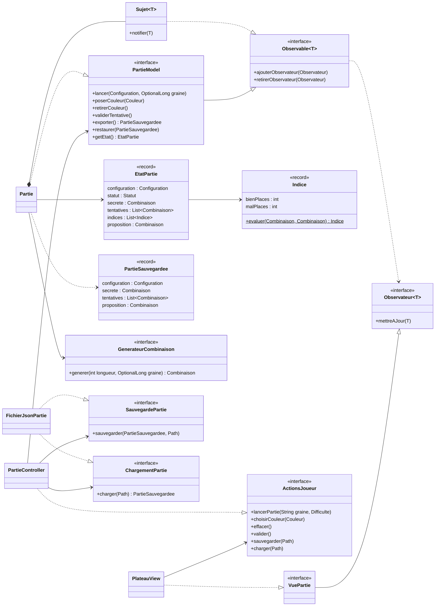
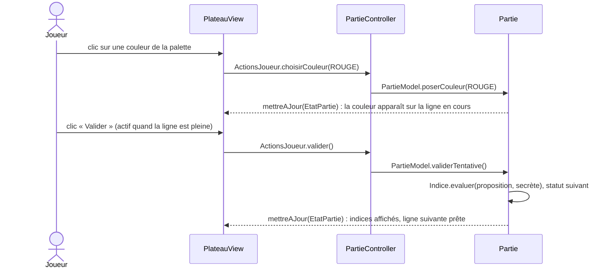
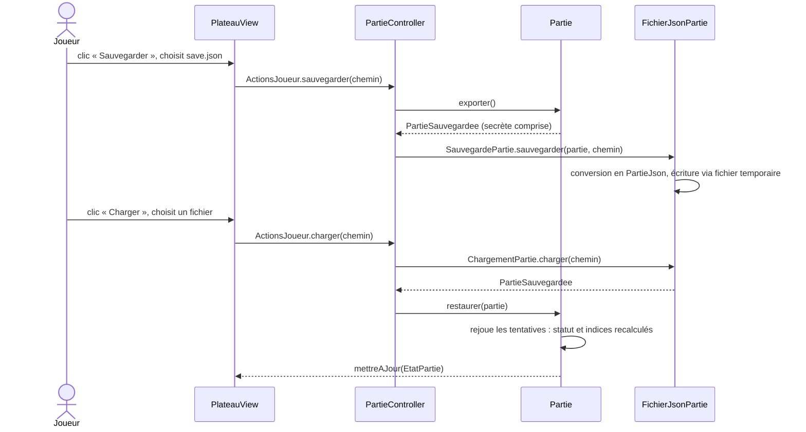

# Mastermind

Jeu de Mastermind en JavaFX, construit en MVC avec le patron Observer. Le joueur devine une combinaison secrète de couleurs en un nombre limité d'essais, guidé par des indices (pions bien placés / mal placés).

> État actuel : jeu complet. Lancement avec graine et difficulté, saisie et correction des tentatives, indices selon la règle officielle, victoire et défaite, combinaison secrète révélée en fin de partie, sauvegarde et chargement d'une partie au format JSON.

## Stack

| Élément | Choix |
|---|---|
| Langage | Java 21 (records, `switch` exhaustif, `List.reversed()`) |
| Interface | JavaFX 21.0.5 (`javafx-controls`), style entièrement en CSS |
| Sauvegarde | Gson 2.10.1 (JSON) |
| Build | Maven (`demo/pom.xml`) |
| Tests | JUnit 5.10, doublures écrites à la main (pas de framework de mock) |
| Plugins Maven | `javafx-maven-plugin` (lancement), `maven-surefire-plugin` (tests) |

## Lancer le projet

Prérequis : Java 21 et Maven 3.9+. Commandes depuis `demo/` :

| Commande | Effet |
|---|---|
| `mvn javafx:run` | Lance le jeu |
| `mvn test` | Lance les tests |

Depuis VS Code, lancer `com.mastermind.Launcher` (et non `Main`) : `Launcher` n'étend pas `Application`, ce qui évite l'erreur « JavaFX runtime components are missing » quand JavaFX est sur le classpath.

## Règles du jeu

- Combinaison de 4 pions parmi 6 couleurs, répétitions autorisées.
- Indice d'une tentative : nombre de pions **bien placés** (bonne couleur, bonne position) et **mal placés** (bonne couleur, mauvaise position), sans dire lesquels. Un pion de la secrète ne compte qu'une fois.
- Difficulté : **Facile** 14 essais, **Difficile** 8 essais.
- Gagné quand les 4 pions sont bien placés, perdu quand les essais sont épuisés ; la secrète est alors révélée.

## Architecture

### Vue d'ensemble

```
com.mastermind
├── Main, Launcher
├── observer                 Observateur, Observable, Sujet
├── model
│   ├── partie               PartieModel, Partie, EtatPartie, PartieSauvegardee, Statut, Configuration, Difficulte
│   ├── combinaison          Combinaison, Couleur, Indice
│   ├── generation           GenerateurCombinaison, GenerateurAleatoire
│   └── sauvegarde           SauvegardePartie, ChargementPartie (ports), ErreurSauvegarde
├── data                     FichierJsonPartie, ConvertisseurPartieJson, PartieJson
├── controller               PartieController
└── view                     ActionsJoueur, VuePartie, PlateauView, DialoguesFichier
    └── component
        ├── atoms            Bouton, BoutonCouleur, ChampTexte, ChoixDifficulte, Case, Indice, EtatIndice,
        │                    StatutPartie, PseudoClasses
        ├── molecules        LignePions, GrilleIndices
        └── organisms        LigneTentative
```

Ressources : `demo/src/main/resources/com/mastermind/view/mastermind.css`.

### Principes

- **MVC strict.** Le contrôleur traduit une intention du joueur en appel au modèle. Il ne touche jamais la vue : la vue observe le modèle et se redessine d'elle-même.
- **Observer par composition.** `Partie` délègue à un `Sujet<EtatPartie>` au lieu d'en hériter. Les observateurs sont dans une `CopyOnWriteArrayList` : l'un d'eux peut se désabonner pendant une notification.
- **Un seul point de changement d'état.** `Partie.changerEtat` remplace l'état et notifie : aucune modification n'échappe aux observateurs.
- **État immuable.** `EtatPartie` est un instantané (record) : c'est la seule chose que la vue lit, elle n'accède jamais à `Partie`. Il porte la configuration : la vue dimensionne le plateau à partir de l'état reçu.
- **Secrète cachée.** L'état publié contient une combinaison vide tant que la partie est en cours ; seule `PartieSauvegardee`, réservée à la sauvegarde, contient la vraie secrète.
- **La vue n'autorise que le possible.** Palette, Effacer, Valider et Sauvegarder ne sont actifs que si le modèle accepte l'action dans l'état courant.
- **Ports et adaptateurs.** Le modèle définit les ports `SauvegardePartie` et `ChargementPartie` ; le package `data` les implémente. Le modèle ne dépend d'aucune technologie de stockage.
- **Inversion de dépendance.** Le contrôleur dépend de `PartieModel` et des ports, la vue de `ActionsJoueur`, la partie de `GenerateurCombinaison`. Seul `Main` fait des `new` concrets (racine de composition).
- **Hasard injecté.** `GenerateurCombinaison` est une interface : `GenerateurAleatoire` en production, une lambda fixe dans les tests. Une graine permet de rejouer la même combinaison.
- **Le Java choisit l'état, le CSS décide du rendu.** `PseudoClasses` relie une valeur d'enum (`Couleur.ROUGE`, `EtatIndice.MAL_PLACE`) à une pseudo-classe CSS (`:rouge`, `:mal-place`). Le modèle ne contient aucune information de rendu, ni texte d'interface.
- **Composants en atomic design.** atoms → molecules → organisms, chacun ne dépendant que du niveau inférieur.

### Diagramme de classes



### Flux : jouer une tentative



### Flux : sauvegarde et chargement



Le fichier ne contient que les données de base ; le statut et les indices sont recalculés au chargement, donc un fichier modifié à la main ne peut pas produire une partie incohérente. Toute erreur (fichier illisible, JSON invalide, partie impossible) remonte en `ErreurSauvegarde` et la vue l'affiche dans une boîte de dialogue ; la partie courante reste alors inchangée.

Format du fichier :

```json
{
  "version": 1,
  "longueur": 4,
  "nbEssais": 14,
  "secrete": ["ROUGE", "VERT", "VERT", "BLEU"],
  "tentatives": [["VERT", "VIOLET", "JAUNE", "BLEU"]],
  "proposition": ["ROUGE"]
}
```

### Règles de dépendance

| Package | Peut dépendre de | Ne dépend jamais de |
|---|---|---|
| `observer` | rien | tout le reste |
| `model.combinaison` | rien | tout le reste |
| `model.generation` | `model.combinaison` | `model.partie`, `view`, `controller`, `data`, JavaFX |
| `model.partie` | `model.combinaison`, `model.generation`, `observer` | `model.sauvegarde`, `view`, `controller`, `data`, JavaFX |
| `model.sauvegarde` | `model.partie` | `view`, `controller`, `data`, JavaFX |
| `data` | `model`, Gson | `view`, `controller`, JavaFX |
| `controller` | `model` (interfaces et ports), `view.ActionsJoueur` | vue concrète, `data`, JavaFX |
| `view.component.atoms` | `model` (records et enums), JavaFX | molecules, organisms, `view` |
| `view.component.molecules` | atoms | organisms, `view` |
| `view.component.organisms` | molecules (et atoms) | `view` |
| `view` | components, `model` (lecture seule), `observer` | `Partie`, `PartieController`, `data` |
| `Main` | tout | — seul endroit qui fait des `new` concrets |

## Tests

| Classe | Vérifie |
|---|---|
| `IndiceTest` | Règle des indices sur des cas choisis, plus comparaison avec un algorithme de référence sur toutes les paires de combinaisons |
| `CombinaisonTest` | Immuabilité, ajout et retrait de pions, comptage des couleurs |
| `PartieTest` | Cycle de vie, actions refusées, victoire et défaite, secrète cachée, notifications, difficulté, export et restauration. Générateur factice : aucun hasard |
| `EtatPartieTest` | Cohérence et immuabilité de l'état publié |
| `PartieSauvegardeeTest` | Cohérence des dimensions d'une partie sauvegardée |
| `ConfigurationTest`, `DifficulteTest` | Paramètres de partie et niveaux de difficulté |
| `GenerateurAleatoireTest` | Longueur demandée, même graine → même combinaison |
| `FichierJsonPartieTest` | Aller-retour par fichier, format JSON, remplacement sans fichier temporaire résiduel, erreurs (fichier absent, vide, corrompu, version, couleur, champ manquant) |
| `PartieControllerTest` | Conversion de la saisie et transmission des actions, avec un modèle espion et de faux ports de sauvegarde |

La vue JavaFX n'est pas testée automatiquement.

## Étendre le projet

- **Ajouter une couleur** : ajouter la valeur dans `Couleur` **et** sa règle `.case:<couleur>` et `.pastille:<couleur>` dans `mastermind.css`, sinon le pion est invisible.
- **Ajouter un statut** : ajouter la valeur dans `Statut`. Le `switch` de `StatutPartie` cesse de compiler tant que le libellé n'est pas fourni.
- **Ajouter une difficulté** : ajouter la valeur dans `Difficulte` avec son nombre d'essais. Le `switch` de `ChoixDifficulte` cesse de compiler tant que le libellé n'est pas fourni.
- **Ajouter une source de combinaison** (saisie par un joueur, fichier...) : implémenter `GenerateurCombinaison` et l'injecter dans `Main`.
- **Ajouter un autre stockage** (base de données, autre format...) : implémenter `SauvegardePartie` et `ChargementPartie`, puis les injecter dans `Main`. Modèle et contrôleur ne changent pas.
- **Faire évoluer le format JSON** : incrémenter `ConvertisseurPartieJson.VERSION` ; les fichiers d'une autre version sont refusés avec un message clair.
- **Ajouter une autre vue** (console...) : implémenter `VuePartie`, l'abonner au modèle dans `Main`. Contrôleur et modèle ne changent pas.

## Conventions de code

Convention d'équipe, vérifiée à la relecture :

- Chaque classe, méthode et constructeur (privés compris) a une Javadoc, toujours sur plusieurs lignes :
  ```java
  /**
   * Description.
   *
   * @param ...
   */
  ```
- La doc d'un contrat vit sur l'interface. Une méthode `@Override` n'a pas de Javadoc : elle hérite automatiquement de celle de l'interface.
- Les méthodes `@Test` ne sont pas documentées : leur nom (`quand_alors`) sert de documentation.
- Aucun commentaire dans le corps d'une méthode, aucun `//`, aucun `TODO` : ce qui reste à faire va dans la feuille de route ci-dessous.
- Noms du domaine en français (`Partie`, `Combinaison`, `mettreAJour`).

## Feuille de route

- **Contrôle d'entrée** : `PartieController` doit valider lui-même la graine au lieu de compter sur le filtre de la vue.
- **Sauvegarde** : la combinaison secrète est écrite en clair dans le fichier ; la masquer si la triche devient un sujet.
- **Vue** : afficher le nombre d'essais restants ; tester la vue automatiquement.
